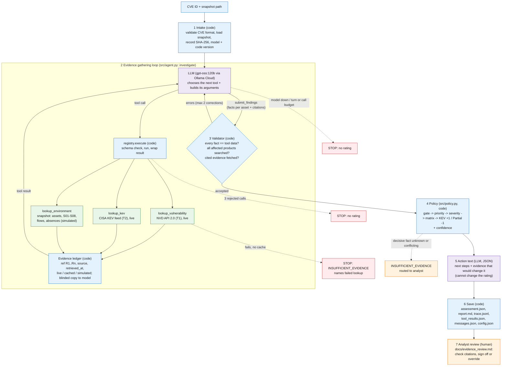

# Architecture and design (Step 1)

**Owner:** Student C/D (agent, validation, diagram) building on Student A's policy and Student B's tools.
**Applies to:** `src/` at the commit recorded in each run's `config.json`.

## 1. Risk question, scope and output

| Item | Definition |
|---|---|
| **Risk question** | What is the risk that **CVE-2026-85880** is exploited on Northbridge Services assets, given environment snapshot `northbridge-v1.1` (as of 2026-10-01)? |
| **Input** | One CVE ID (`--cve`, default CVE-2026-85880) and one environment snapshot (`--snapshot`, default `environment/northbridge-v1.1.json`). The agent is **not** told which machines to look at; it has to find them. |
| **Input scope** | One threat at a time. External evidence: NVD (T1) and CISA KEV (T2). Local evidence: the simulated Northbridge snapshot and its evidence records S01–S08. Out of scope: scanning, exploit testing, EPSS, MSRC page (T3, not machine-readable). |
| **Target environment** | Northbridge Services v1.1, adapted by Student A from the course Windows enterprise scenario (`environment/CHANGES.md`). All local data is `source_mode: simulated`. |
| **Required output** | `outputs/<run>/assessment.json`: one decision per affected asset record (**High / Medium / Low / INSUFFICIENT_EVIDENCE**), with rationale, policy rule, evidence citations, assumptions, unknowns, confidence and recommended action. Also `report.md` (readable), `trace.jsonl`, `tool_results.json`, `messages.json`, `config.json`. |

**Severity is not risk.** CVSS (7.8 High) is the flaw's general technical severity, the same for everyone. The decision is **local risk**: severity combined with applicability (can it work here?) and impact (how much would it hurt here?). The same CVE is High on W15 and Low on a patched DHCP server.

## 2. Workflow diagram

Pattern: **a single tool-using agent (augmented LLM in a loop) wrapped in deterministic code, plus an evaluator gate.** The model plans the investigation and extracts facts. Code validates the facts (the evaluator) and applies the policy. A human reviews the result. We did not use multiple agents: one CVE against one snapshot needs no parallel workers, and the course guidance is to use the simplest architecture that works.

A rendered copy is in `docs/workflow.png` (generated from `docs/workflow.mmd`).

**Legend:** purple = LLM, blue = deterministic code, green = tools / sources, orange = human, red = stop paths.

## 3. Who does what: model, code, tool, human

| Step | Actor | What happens | Decision point |
|---|---|---|---|
| 1 Intake | Code | Checks the CVE matches `CVE-YYYY-NNNN`, loads the snapshot, hashes it, records model, prompt and git versions | Bad CVE ID → refuse before any call |
| 2 Evidence gathering | **LLM** | Picks which tool to call next and builds its arguments: which product strings to search (`"Windows Server 2016"`, `"Windows 10"`), which evidence IDs to fetch, when to use `check_absence`. **This is the model's tool-selection and query-construction decision required by the assignment** | Model decides it has enough and calls `submit_findings` |
| 2 Tool execution | Code + tools | `registry.execute` validates arguments against the schema, runs the lookup, retries external sources once, falls back to cache, labels every result | Unknown tool / bad arguments → rejected, counted |
| 2 Fact extraction | **LLM** | For each asset record: affected product label, OS build, fixed build, build below fixed?, low-privilege access, conflicts between evidence and record | — |
| 3 Output validation | Code | `src/validation.py` checks every extracted fact against the tool result it came from, checks that every affected product was searched in the environment, that every asset running an affected product is included, and that its cited evidence was fetched. Errors go back to the model | Pass → policy. Fail → model corrects (max 2 times). Still failing → that asset becomes INSUFFICIENT_EVIDENCE |
| 4 Policy | Code | `src/policy.py` applies `docs/rating_policy.md` to the **validated tool data**, not to the model's words | Gate: not applicable → Low; unknown/conflict → INSUFFICIENT_EVIDENCE |
| 5 Action drafting | **LLM** | Writes recommended next steps and "evidence that would change the decision" for non-Low assets. Low assets use a fixed template | Model failure → template text, labeled |
| 6 Save | Code | Writes the assessment, the full trace and every raw tool result | — |
| 7 Review | **Human** | An analyst checks the decision and every citation with `docs/evidence_review.md` and signs off or overrides | Any INSUFFICIENT_EVIDENCE asset needs a human |

The model **never** chooses the rating. It cannot change a build number or an access flag either: the validator rejects any value that does not match the tool data.

## 4. Tool contracts

Full contracts with real request/response examples are in `docs/tool_contracts.md` (Student B). Summary of each tool's role in the decision:

| Tool | Purpose | Inputs | Outputs used | Attribution | Role in the risk decision |
|---|---|---|---|---|---|
| `lookup_vulnerability` | What the CVE is and what it affects | `cve_id` | CVSS v3.1 score/vector (and whose score), affected products, `versionEndExcluding` fixed builds, NVD's KEV fields | T1, NVD URL, `retrieved_at`, `live`/`cached` | **Decisive:** affected product and fixed build (applicability), CVSS band (severity) |
| `lookup_kev` | Is it exploited in the wild? | `cve_id` | `in_kev`, `dateAdded`, `dueDate`, `requiredAction` | T2, CISA feed URL, catalog version | KEV +1 modifier; due date in the action. Absence ≠ safe |
| `lookup_environment` | What Northbridge runs and how important it is | `action` + `query` (+ `limit` for search) | Asset records (OS build, data, exposure, low-privilege access, overrides), evidence S01–S08, flows, documented absences | Snapshot locator (`northbridge-v1.1.json#assets[17]`), `simulated` | **Decisive:** OS build and access path (applicability). Data, exposure, override (impact/priority) |
| `submit_findings` | Hand facts to code | One finding per asset record + summary | — | — | Triggers validation; code, not the model, then rates |

## 5. Evidence flow

1. Every tool result enters the **evidence ledger** with a reference (`R1`, `R2`, …), its source URL or snapshot locator, `retrieved_at`, `status` and `source_mode` (`live`, `cached` or `simulated`).
2. The model receives a **blinded** copy: the snapshot file name and ID are replaced with `snapshot.json` / `northbridge-snapshot`. A test variant (`env_conflict.json`, ID `...-conflicting_evidence`) therefore cannot reveal the expected answer to the model. The ledger keeps the real names, so citations in the assessment use real locators.
3. The validator reads facts **from the ledger**, not from the model's text.
4. Each assessed asset cites: the asset record (R#, locator), every evidence record it lists (S0x), the NVD result (T1), and the KEV result (T2) when it affects the rating. Assumptions A1–A15 that touch the asset are pulled from `environment/CHANGES.md`.

## 6. Rating policy

The policy is Student A's `docs/rating_policy.md` v1.0, implemented in `src/policy.py`. `tests/test_policy.py` checks that it matches `reference/policy_reference.py` on every asset of the base snapshot and all four variants (5 × 48 records).

Summary: **applicability gate** (Confirmed / Partial / Not applicable / Unknown / Conflict) → **machine priority** P1–P3 from data sensitivity × exposure, with P1 overrides → **severity band** from CVSS → **matrix** → **KEV +1, then Partial −1**. Unknown or conflicting decisive facts → **INSUFFICIENT_EVIDENCE**. Justifications for each cell are in the policy document.

Two small gaps in the written policy were filled conservatively in code and should be confirmed by the group:

| Gap | What the code does | Why |
|---|---|---|
| KEV lookup fails and no cache, but NVD carries KEV fields | Uses NVD's `cisaExploitAdd` fields, labeled as the source | NVD republishes CISA's KEV data, so it is the next-best source |
| KEV status unknown from every source | No modifier; confidence Low; rule says "KEV status unknown" | The policy says KEV absence must not lower a rating, but does not say what unknown does |
| Priority field (data or exposure) null | INSUFFICIENT_EVIDENCE | The matrix cannot be applied; same logic as unknown severity (no current asset is affected) |

## 7. Failure paths and stop rules

| Situation | Where | What happens | Rating? |
|---|---|---|---|
| NVD or KEV unreachable | `src/sources/_fetch.py` | Retry once, then cached copy (`status: cached`); confidence at most Medium | Yes |
| NVD unreachable **and no cache** | `src/agent.py` | **Stop immediately.** Overall INSUFFICIENT_EVIDENCE; stop reason names `lookup_vulnerability` | No per-asset rating |
| NVD has no record for the CVE | `src/agent.py` | Same stop as above | No |
| Model calls a tool that doesn't exist, or bad arguments | `registry.execute` | Rejected with an error message the model can read; model continues. **After 3 rejected calls: stop, no rating** | No (after 3) |
| Model's facts don't match tool data | `src/validation.py` | Errors sent back; up to 2 corrections. Assets still wrong → INSUFFICIENT_EVIDENCE. Coverage gaps still open → overall INSUFFICIENT_EVIDENCE (never "Low" by omission) | Partial |
| Model answers in text instead of calling tools | `src/agent.py` | Reminder; after 2 text replies: stop | No |
| Model service down / errors | `src/llm.py` | Retry 5 times with backoff, then stop with `stopped_model_error` | No |
| Turn or tool-call budget used up (30 / 60) | `src/agent.py` | Stop | No |
| Decisive fact null (e.g. build) | `src/policy.py` | That asset: INSUFFICIENT_EVIDENCE, routed to analyst | No (that asset) |
| Evidence record disagrees with asset record | `src/validation.py` + policy | That asset: Conflict → INSUFFICIENT_EVIDENCE, both sources named | No (that asset) |
| Non-decisive fact null (e.g. `encryption_at_rest`) | report | Listed under `unknowns.non_decisive`; rating continues | Yes |

Each stop writes the same saved files, so a failed run is as auditable as a successful one.

## 8. Human review

Analysts review **every** run before it is acted on. INSUFFICIENT_EVIDENCE assets need a human to obtain the missing fact. The checklist is `docs/evidence_review.md`. Every saved assessment carries `human_review.status: pending` until someone signs off.

## 9. Acceptance test

**The complete workflow passes if**, for CVE-2026-85880:

1. the live run on `northbridge-v1.1` completes with model-chosen tool calls to NVD, KEV and the environment, and rates **W15 High** by rule `P1 x High = High; KEV +1 -> High`, with each decisive fact cited to a tool result (R#) and source (T1/T2/S0x), and
2. every policy check and controlled failure in `tests/expected_results.json` gives the expected result: applicability change → Low, impact change → Medium, missing → INSUFFICIENT_EVIDENCE, conflict → INSUFFICIENT_EVIDENCE naming S08 and the asset record, NVD down with cache → still High at ≤ Medium confidence, NVD down without cache → stop with INSUFFICIENT_EVIDENCE naming the lookup, invalid tool → rejected and the run continues, and
3. a group member completes `docs/evidence_review.md` for the main run.

Run: `python -m src.run_checks` (live model) and `python -m pytest` (offline, scripted model). Results: `docs/test_results.md`.

## 10. Changes between design and implementation

| Design (Student A handoff, policy v1.0) | Implementation | Why |
|---|---|---|
| Main case: assess W15 | Input is the CVE only; the agent finds every affected asset record, and W15 is the focus of the tests | Puminun's clarification: ask the tool whether a CVE affects any machine. It also matches section 4 of `expected_results.md` |
| "Model extracts decisive facts" | Model extracts facts **and** code verifies each one against the tool data before the policy runs (evaluator gate with up to 2 corrections) | First live runs showed the model omitting 20 of 23 assets on the first try; the validator caught it and the model fixed it |
| Tool names in the prompt | The prompt says explicitly that `get_evidence` etc. are actions of `lookup_environment` | The first live run called `get_evidence` as a tool and hit the 3-rejection stop |
| Tool results shown to the model as returned | Blinded snapshot names | Student B noted the variant name leaks the test into the model's context |
| Model retry: once | 5 retries with 3/6/9/12/15 s backoff | Ollama Cloud (free tier) returned intermittent HTTP 500s; replaying the same request succeeded on the next try |
| Failure 4c "model requests a non-existent tool" | Live: the fault replaces the model's first tool request with `scan_network` (1 rejection, the model must recover). Offline: a scripted model makes 3 bad calls (stop) | We first asked the model in the task message to call `scan_network`. It ignored the request (good injection resistance), so the rejection path was not tested. A real model does produce invalid calls now and then: in one run it sent `cve_id: "CVE-202c?"`, which was rejected, and it then retried correctly |
| Tool results sent to the model in full | Compact view: echoed args, timestamps, NVD reference URLs and duplicate unknown-field lists removed (`model_view` in `src/agent.py`). Full results stay in the ledger and `tool_results.json` | Ollama Cloud returned HTTP 500 more often late in long conversations (50–64K characters) |
